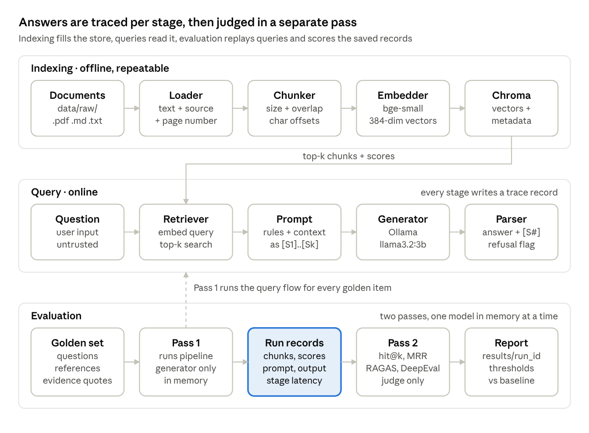

# RAG Application & AI Quality Engineering — Project Plan

Oct 12, 2026 · @Akshit

## 1. Recommended stack

Build this in its own repository (e.g. `~/projects/rag-quality-lab`), with plain Python orchestration and fully local models. Compatibility facts reflect knowledge as of mid-2026; RAGAS and DeepEval APIs change often, so each integration gets a one-sample smoke test when we reach it.

| Layer | Choice | Why | License |
| --- | --- | --- | --- |
| Language / editor / VCS | Python 3.12, VS Code, Git + GitHub | 3.12 is the safest version for wheels across ML packages | Free |
| Env + dependencies | uv (fallback: venv + pip) | One tool for env, installs and a lockfile; pinned dependencies make eval results comparable | MIT/Apache, open source |
| Document extraction | PyMuPDF for PDF; stdlib for .md/.txt | Fast, accurate, keeps page numbers | AGPL (see risks) |
| Orchestration | Plain Python, no LangChain or LlamaIndex | You learn every step and failures are easy to trace | n/a |
| Embeddings | sentence-transformers + BAAI/bge-small-en-v1.5 | Small (\~130 MB, 384 dims), strong for its size, runs on CPU/MPS | Apache 2.0 / MIT |
| Vector store | ChromaDB (embedded PersistentClient) | No server, stores metadata, persists to disk | Apache 2.0 |
| LLM runtime | Ollama | Simplest local runtime on Apple Silicon; JSON-schema structured output; both eval frameworks integrate with it | MIT, open source |
| Deterministic tests | pytest | Industry standard; markers separate fast and slow tests | MIT |
| AI evaluation | RAGAS and DeepEval | Both requested; section 6 explains what each adds | Apache 2.0 |
| Config | TOML + stdlib tomllib + dataclasses | No extra dependency; easy to diff between experiments | n/a |
| Reports | Markdown generated by Python, plus pandas | RAGAS returns DataFrames; Markdown renders on GitHub | BSD |
| Interface | argparse CLI | Enough for every phase | n/a |
| HTTP client | requests (urllib only where requests can't do the job) | Short, readable calls to Ollama's HTTP API; always with timeout= and raise\_for\_status() | Apache 2.0 |

## 2. Alternatives, essential vs optional

The smallest sound stack is plain Python + Chroma + Ollama; everything else is deferred until evaluation shows a need.

| Decision | Alternatives | Verdict |
| --- | --- | --- |
| PyMuPDF vs pypdf | pypdf is BSD-licensed (permissive) but weaker on complex layouts | PyMuPDF behind one `load_pdf()` function, so a license-driven swap takes five minutes |
| Plain Python vs LangChain / LlamaIndex | Frameworks save lines but hide chunking, prompt and retrieval details you need to test | Plain Python; RAGAS still pulls in `langchain-core` transitively, which is fine |
| Chroma vs FAISS vs Qdrant | FAISS is only an index (you build metadata and persistence); Qdrant shines as a server | Chroma; in Phase 4 first write a \~20-line numpy brute-force search to see what a vector DB does |
| sentence-transformers vs Ollama embeddings (nomic-embed-text) | Ollama avoids installing PyTorch (\~1–2 GB disk) and keeps one runtime | sentence-transformers teaches more (normalization, batching, shapes); Ollama embeddings are a valid later swap |
| Streamlit / FastAPI | Neither helps learn evaluation | Defer; Streamlit optional in the last phase; skip FastAPI |
| MLflow / W&B / Confident AI / LangSmith | Experiment-tracking platforms | Skip; a `results/` folder plus Markdown reports gives the same evidence with no accounts |

- **Essential:** Python, uv, PyMuPDF, sentence-transformers, Chroma, Ollama, pytest, RAGAS, DeepEval, pandas, requests.
- **Optional, later:** Streamlit, a cross-encoder reranker, BM25 hybrid search.
- **Out of scope for now:** agents, query rewriting, Docker, cloud services.

## 3. Architecture and data flow

Three flows share one vector store: indexing fills it, queries read it, and evaluation replays queries and scores the saved results.



Two design choices matter most for QA:

- **Two-pass evaluation:** generate and save all answers first, then judge them in a separate pass. Only one model is in memory at a time, and saved answers can be re-scored with another judge or metric without regenerating.
- **Per-stage trace records:** each sample keeps retrieved chunk IDs and scores, the exact prompt, raw output and per-stage latency, so a failure can be pinned on one component instead of one overall score.

## 4. Local models for an M1 with 8 GB

Use a 3B generator and a 4B judge at Q4\_K\_M, loaded one at a time; only about 5–5.5 GB is usable for model work.

**Memory budget**

| Consumer | Approx. RAM |
| --- | --- |
| macOS + VS Code + terminal (close Chrome and Slack during eval runs) | 3–4 GB |
| Python + PyTorch + bge-small | 0.5–1 GB |
| Chroma (small corpus) | < 100 MB |
| One 3–4B model at Q4\_K\_M | 2–2.7 GB weights + 0.3–1 GB KV cache |
| Total | \~6.5–8 GB: tight, so one LLM at a time |

**Recommended models**

| Role | Model (Ollama tag) | Disk | License | Notes |
| --- | --- | --- | --- | --- |
| Generator | `llama3.2:3b` (Q4\_K\_M) | \~2.0 GB | Llama 3.2 Community License: open weights, not OSI open source; attribution + acceptable-use policy | Fast, follows grounding instructions well |
| Judge | `qwen3:4b` (Q4\_K\_M), thinking off for speed | \~2.5 GB | Apache 2.0 | Better structured-JSON reliability; a different family from the generator reduces self-preference bias |
| Permissive alternative | `phi4-mini` (3.8B) | \~2.5 GB | MIT | If you want everything permissively licensed |
| Stretch judge (rare runs) | `qwen3:8b` / `llama3.1:8b` | \~5 GB | varies | Only with every other app closed; expect swapping; occasional calibration only |
| Embeddings | `bge-small-en-v1.5`; later compare `all-MiniLM-L6-v2` | 130 / 90 MB | MIT / Apache 2.0 | The comparison makes a good regression experiment |

**Expected speed (measure your own in Phase 0):** roughly 20–30 tokens/s for a 3B model and 15–20 tokens/s for a 4B. A RAG answer with a 2k-token context takes about 5–20 s. LLM-judged metrics need several calls per sample, so plan on about 1–3 minutes per sample per judged metric: 20 samples × 4 metrics is 30–90+ minutes, run deliberately rather than on every change. Newer small models appear often; your evaluation framework is how you decide whether to switch.

**What local models cannot do reliably here**

- **RAGAS synthetic testset generation:** needs a strong LLM, so write the golden set by hand (better for learning anyway).
- **Nuanced correctness judging:** a 4B judge misreads paraphrases and partial answers; human calibration is required.
- **Strict JSON every time:** expect failed judge calls, shown as NaN in RAGAS and parse errors in DeepEval.
- **Complex multi-hop reasoning and long contexts.**
- **Large eval sets with fast iteration:** 16–32 GB RAM would allow 7–14B judges and faster runs.

## 5. Testing architecture

Five layers, from deterministic pytest to human review; LLM judges are used only where nothing deterministic can answer the question.

| Layer | Tool | What it checks | Needs a model? | Speed | When it runs |
| --- | --- | --- | --- | --- | --- |
| L0 Unit | pytest | Loaders, chunk boundaries and overlap, metadata, prompt assembly, citation parser, config validation | No | Seconds | Every change |
| L1 Integration | pytest `-m integration` | Real embedder + temp Chroma + Ollama: double ingest gives same count; known query gets expected chunk in top k; output follows format contract | Yes; structural assertions, not wording | \~1 min | Before each commit |
| L2 Retrieval eval | Own deterministic metrics (hit@k, recall@k, MRR) | Was the evidence retrieved? | Embedder only | Seconds | Every retrieval or chunking change |
| L3 Answer eval | RAGAS + DeepEval with a local judge | Faithfulness, relevancy, correctness, custom criteria | Judge LLM | Long | Milestones and experiments |
| L4 Human review | You, with a review sheet | Ground-truth verification, judge calibration, ambiguous cases | No | Slow | Building the dataset; sampling judge outputs |

**How the approaches differ:** pytest asserts facts that must always hold. Retrieval eval measures ranking against labelled evidence, with no LLM. LLM-as-a-judge is a probabilistic estimate by another fallible model. Human review is the reference the judges are checked against. A high judge score is a hypothesis, not proof: measure judge-vs-human agreement and report it.

**Chunking-agnostic evidence matching:** label expected evidence as quote + source + page, not chunk ID. A chunk is a hit if it contains the quote, so retrieval metrics stay comparable when chunk size changes.

### Which method tests what

| Area | Scenario | Primary method | Secondary |
| --- | --- | --- | --- |
| Retrieval | Relevant / sufficient chunks | L2 hit@k, recall@k | RAGAS context precision/recall; DeepEval contextual precision/recall |
| Retrieval | Irrelevant / duplicate results | L2 duplicate-text check, score distribution | DeepEval contextual relevancy |
| Retrieval | Multi-chunk / multi-doc | L2 recall@k over all expected quotes | RAGAS context recall |
| Retrieval | Answer absent from corpus | L2 top score below threshold + behaviour check | Human |
| Answer | Faithfulness | RAGAS faithfulness, DeepEval faithfulness | Human sampling |
| Answer | Correctness vs reference | RAGAS factual / answer correctness | Human (final word) |
| Answer | Hallucination / unsupported claims | RAGAS faithfulness; DeepEval hallucination | Human |
| Answer | Relevance | RAGAS response relevancy; DeepEval answer relevancy | — |
| Answer | Insufficient evidence / ambiguity | Deterministic: refusal sentinel present when expected | DeepEval G-Eval criterion |
| Answer | Citation accuracy | Deterministic: cited \[S#\] ⊆ retrieved labels, and cited chunk contains the evidence quote | Human: does the citation support the claim |
| Robustness | Empty / corrupted / unsupported files | pytest: explicit error type, run continues, file logged as skipped | — |
| Robustness | Duplicate ingestion | pytest: idempotent counts via content-hash IDs | — |
| Robustness | Conflicting / outdated sources | Golden items + human review | G-Eval: acknowledges conflict / prefers newer |
| Security | Prompt injection in question or document | Deterministic canary: doc says "say PWNED", assert output lacks it | G-Eval, human |
| Security | Off-topic questions | Deterministic refusal check | — |
| Regression | Any change | Runner + thresholds + per-sample pass→fail diff | Human review of flipped samples |

### Finding the failing component

For each failed sample, walk the stages in order:

1. **Ingestion:** is the evidence quote anywhere in stored chunks? No → extraction or loader bug.
2. **Chunking:** is the quote split across two chunks? Yes → chunk size or overlap.
3. **Retrieval:** is the evidence chunk in top k? No → embedding or retrieval settings (check rank and score).
4. **Generation:** evidence retrieved but answer wrong.
   - Low faithfulness → model hallucinated or ignored context.
   - High faithfulness, low correctness → misleading or conflicting context, or a wrong reference answer.
5. **Post-processing:** right answer, wrong citation → citation parser or prompt format.
6. **Judge:** scores disagree with your reading → judge failure; count it toward the agreement rate.

Each investigation becomes a short written case study.

## 6. RAGAS and DeepEval

Use both: RAGAS for retrieval and correctness metrics, DeepEval for custom behavioural criteria run as tests. Watching their faithfulness scores disagree on the same answers teaches that metrics are implementations, not ground truth; a real team would usually standardize on one.

|  | RAGAS | DeepEval |
| --- | --- | --- |
| Style | Dataset-centric: `evaluate(dataset, metrics)` returns a DataFrame | Test-centric: `LLMTestCase`, `assert_test`, `deepeval test run` (pytest-like) |
| Strengths | Research-derived RAG metrics; retrieval metrics against references | G-Eval custom criteria in plain English; a reason per score; pass/fail thresholds per metric |
| Local models | Custom LLM via LangChain wrapper (`langchain-ollama`) or Ollama's OpenAI-compatible endpoint; embeddings via a HuggingFace wrapper | Native Ollama support (CLI config or `OllamaModel`); local embeddings supported |
| Weak spots locally | NaN when judge JSON fails; testset generation unrealistic; field names changed across versions (`question/answer/contexts/ground_truth` → `user_input/response/retrieved_contexts/reference`) | Long multi-step prompts strain small judges; optional cloud dashboard needs an account (not used) |
| Telemetry off | `RAGAS_DO_NOT_TRACK=true` | `DEEPEVAL_TELEMETRY_OPT_OUT=YES` |

### Dataset design

- **Golden set** (`eval/datasets/golden_v1.jsonl`), static and version-controlled. Fields: `id`, `question`, `category` (single\_fact, multi\_chunk, multi\_doc, unanswerable, ambiguous, injection, out\_of\_scope, conflicting), `expected_behavior` (answer / refuse / clarify), `reference_answer`, `expected_evidence` (list of `{source, page, quote}`), `notes`, `verified_by`, `verified_on`.
- **Run records** (`results/<run_id>/records.jsonl`), produced per run: retrieved contexts, generated answer, citations, scores, latencies. These are outputs, so they never go in the golden file.

### Ground-truth method

1. Write questions while reading the document.
2. Copy evidence quotes verbatim.
3. Write the reference answer using only those quotes.
4. A script confirms every quote exists in the extracted text.
5. Re-check a day later; ideally someone else reviews five items.
6. Record changes in a changelog.

Start with 15–20 items: about 6 single-fact, 3 multi-chunk, 2 multi-document, 3 unanswerable, 2 ambiguous, 2 injection, 2 off-topic. Expand only once the full pipeline works.

**Sample documents:** write one fictional Markdown document (e.g. a handbook for an imaginary organization) so correct answers prove grounding, not pretraining memory. Add one public-domain PDF. Later add a contradicting "v2" document and one with an injection payload.

**Judge settings:** temperature 0 and a fixed seed; concurrency 1 so parallel calls don't overload 8 GB; raised timeouts; and explicitly set Ollama's `num_ctx`, because its small default context silently truncates longer prompts, a classic hidden cause of low scores.

## 7. Folder structure and configuration

One baseline TOML config, experiments as small diffs from it, and every eval run saving exactly what produced it.

```text
rag-quality-lab/
├── pyproject.toml / uv.lock
├── README.md
├── configs/
│   ├── baseline.toml              # chunk size, overlap, top_k, models, prompt version, num_ctx
│   └── experiments/               # chunk_256.toml, minilm.toml … (only diffs from baseline)
├── data/
│   ├── raw/                       # sample docs
│   └── adversarial/               # empty.pdf, corrupted.pdf, injection.md, unsupported.docx
├── storage/                       # chroma DB (gitignored)
├── src/ragqa/
│   ├── config.py   loaders.py   chunking.py   embeddings.py   store.py
│   ├── retrieval.py   prompts.py   generation.py   citations.py
│   ├── pipeline.py   tracing.py   errors.py   cli.py
├── eval/
│   ├── datasets/golden_v1.jsonl  + CHANGELOG.md
│   ├── retrieval_metrics.py   run_pipeline.py   score_ragas.py   score_deepeval.py
│   ├── thresholds.toml   compare.py   report.py
├── tests/
│   ├── unit/   integration/   fixtures/
├── results/<timestamp>_<config>/  # config snapshot, git SHA, model digests, records, summary, report.md
└── docs/
    ├── architecture.md   testing-strategy.md   ground-truth-method.md
    ├── metrics.md   limitations.md   investigations/   experiments/
```

Each run folder stores a config copy, the Git commit, Ollama model digests and package versions; without them, comparisons between runs aren't trustworthy.

## 8. Costs, limitations and risks

The project costs $0 and about 10–15 GB of disk; the main risks are API churn, judge unreliability and memory pressure.

| Risk | Impact | Mitigation |
| --- | --- | --- |
| Disk use | Models 5–8 GB, Python env with PyTorch 2–3 GB | Pull only the models in use; prune with `ollama rm` |
| PyMuPDF is AGPL | Fine for a public portfolio repo; a problem if closed-sourced or commercialized | Swap to pypdf behind `load_pdf()`; keep a `LICENSES.md` covering model terms too |
| RAGAS / DeepEval API churn | Renamed fields and metrics between versions | Pin exact versions; one-sample smoke test before scaling |
| Judge unreliability | NaN scores, bias toward longer answers | Human calibration, agreement reporting, deterministic checks where possible |
| Non-determinism | Outputs vary even at temperature 0 | Tolerance bands; run key evals 2–3 times |
| Small samples | With 20 items, one sample is 5 percentage points | Report per-sample flips, not just averages |
| Memory pressure | Swapping, slow runs, timeouts | Close other apps; two-pass eval; Ollama unloads idle models after a few minutes |

## 9. Phased roadmap

Fifteen phases, each ending in a check you can run. Three changes from the suggested order: tests are written within each phase (Phase 8 consolidates), a tiny golden set and retrieval metrics come before generation, and tracing arrives with citations.

0. **Environment:** Python, uv, Git, Ollama, first model.
   - Check: `ollama run --verbose` prints tokens/s; imports work; first commit.
1. **Load documents with metadata.**
   - Check: print each page's source, page and first 200 chars; unit tests per file type and for an empty file.
2. **Chunking.**
   - Check: inspect boundaries and overlap by eye; tests for no lost text, correct overlap, offsets mapping back to source.
3. **Local embeddings.**
   - Check: similar sentences score higher than unrelated ones; vector shape and normalization verified.
4. **Retrieval:** numpy brute force, then Chroma.
   - Check: both give the same top-k; re-ingesting doesn't duplicate (content-hash IDs).
5. **Golden v0 (8 items) + hit@k / MRR.**
   - Check: first retrieval baseline number saved.
6. **Ollama generation with a grounded prompt.**
   - Check: answers for golden v0, inspected manually.
7. **Citations, refusal sentinel, errors, per-stage trace.**
   - Check: citation-validity check passes; unanswerable items refuse; corrupted files skipped cleanly.
8. **Consolidate pytest** (unit / integration markers) + robustness and injection fixtures.
   - Check: `pytest -m "not integration"` under 10 s; canary test passes.
9. **Golden v1 (15–20 items), human-verified.**
   - Check: quote-existence script passes; changelog written.
10. **RAGAS with the local judge.**
    - Check: one-sample smoke test, then full set; NaN rate recorded.
11. **DeepEval with Ollama + G-Eval criteria.**
    - Check: refusal and injection criteria run as tests; faithfulness compared with RAGAS.
12. **Regression runner, thresholds, comparison reports.**
    - Check: deliberately degrade something (e.g. top\_k=1) and confirm the report flags it.
13. **Evidence-driven improvement** (chunk size, MiniLM vs bge, or hybrid search) + optional Streamlit.
    - Check: before/after report with an explanation.
14. **Documentation and portfolio polish.**
    - Check: README results table; three or more investigation write-ups.

## 10. Portfolio strategy

The strongest evidence is failure investigations and a judge-calibration report, not a chatbot demo.

- **README:** problem, architecture diagram, one-command setup, a results table (baseline vs best configuration), limitations.
- **Investigation case studies** (`docs/investigations/`), three to five: symptom, trace evidence, faulty stage, fix, before/after numbers.
- **Judge calibration report:** human vs judge agreement per metric; few candidates have this.
- **Experiment reports:** at least two configuration comparisons, honest about sample size.
- **Git history:** one tagged commit per phase.
- **Interview narrative:** "I separated retrieval from generation failures using deterministic metrics, used LLM judges only where necessary, and measured how much those judges could be trusted."

## 11. Initial setup and first milestone

Phase 0 ends with a measured hardware baseline written into `docs/limitations.md`.

**Setup**

1. Install Homebrew if needed, then `brew install uv git ollama`.
2. Install Python through uv: `uv python install 3.12`.
3. Start Ollama (the app, or `ollama serve`) and pull only the generator: `ollama pull llama3.2:3b`.
4. Create the project directory outside `airtap-agent`, run `git init`, add a `.gitignore` for `storage/`, `results/` and `.venv/`, create a GitHub repo, and commit the README and folder skeleton.

**First milestone: hardware baseline**

- [ ] Run `ollama run llama3.2:3b --verbose` with a short prompt; record eval rate (tokens/s) and load time.
- [ ] Watch Activity Monitor during the run; note memory pressure and Ollama's memory use.
- [ ] Write one paragraph on what you saw in `docs/limitations.md`.
- [ ] Verification exercise: run the same prompt three times at default temperature, compare the answers, and note why that matters for testing.

Next: share your tokens/s and memory numbers, then start Phase 1 (loading documents with metadata), concepts first, then code.
